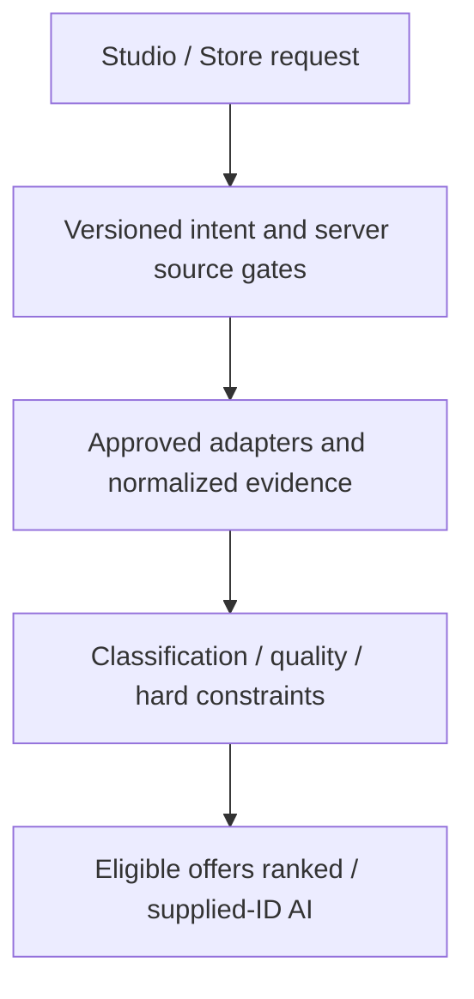

# MATCHLATCH V1.2 — Unified taxonomy and retrieval proposal

2026-10-11 · Preview only · taxonomy/contract1.0.0-preview.

## Outcome and limits

The preceding search corrections were deployed READY at commit `cca62b099e5f6ba90ac4348682ab0f6d198e5887`, deployment `dpl_5yCgn9RWwHkNwK5m2MBdQsbpFqz5`. Browser confirmed the Studio handoff preserves black sneaker, Footwear,USD120,size10, with participating retailer source explicitly selected. Live service returned Black/Hot Pink size10 USD52.50; Store exact black withheld it. No primary-color inference or constraint relaxation. The user’s historical signed-in POST was not captured; source-code, live public reads and authenticated fixture tests distinguish the causes.

The taxonomy and shared-contract code below are **pure internal prototypes**, tested in shadow mode. They are not wired as a new public API, do not query a provider themselves, and do not expand Studio AI to Shopify. Current authorization and permission policy checksum remain intact. No SQL/data/role/env/DNS/billing/Production changes.

Read-only real inventory title audit: **899 inputs →898 watch classifications +1 unknown;846 classified +53 needs review**. The53 are52 legacy watch→shirt conflicts and1 unspecific Michael Kors MK8412 Lexington Two Tone Blue title. The title alone does not justify inferring its product type. Two Dress Quartz watch titles use an explicit contextual modifier rule, not the generic apparel word dress. This is a classification projection, not a shared-data repair. No footwear or actual shirts established.

## Existing providers and authority

| Path | Source contract | Gates / limitations |
|---|---|---|
| Studio catalog / AI: `/api/style` | Mapped Awin rows, USD decimal, `awin:advertiser:variant` IDs | Preview, trusted Supabase auth, consent, public RLS or catalog-staff RPC; fresh source/attribution; AI only supplied qualified IDs after coverage/quota checks |
| Store reviewed feed: `/api/catalog` | Same mapped Awin rows | Public/private gates, category/size/brand/price; color and sneaker-type predicates before60-row public page; private search requires separate catalog staff |
| Store participating retailers: `/api/shop` | Shopify GIDs, API money in integer cents →USD decimal, source availability and retailer variant links | Upstream US/stock/new/budget/attributes, variant validation, user curation/exact color;11sec source timeout. No Awin affiliate claim; delivery unknown without evidence. Existing Preview development discovery profile, custom hosting pending |
| Shopping intelligence: `/api/commerce` | Field-level evidenced records | Awin + reviewed adapter registry (empty) + opt-in indexed research; research not purchasable catalog; consent/auth/budget separate |
| Owner QA: `/api/admin-summary?fixtures=1` | Fictional UI products | Existing verified UUID gate; no real private inventory. Owner≠catalog staff |

Awin membership, feed access, display/image licensing, recommendation permission, affiliate tracking and checkout permission are **different checks**. Shopify availability is not Awin advertiser authorization or verified MATCHLATCH commission attribution. Public visibility/search discoverability is not permission. Do not transplant Store results into Studio merely because a GET succeeds.

## Shared normalized representation

Extend the existing evidence-envelope model in `lib/commerce-intelligence.mjs`; do not create an competing unversioned product database. Internal `normalizeRecord` demonstrates the neutral projection. Actual source adapters must validate source payloads and authoritative permission snapshots; never accept permissions, stock, shipping or eligibility asserted by a client.

| Field group | Required representation / evidence |
|---|---|
| Identity | Provider namespace, merchant ID, product ID, variant ID, optional GTIN/MPN; identities are source-qualified, not matched by title |
| Source | Source type, sanitized source URL, source record timestamp, source-check time, observation time, expiration, contract and adapter version |
| Original metadata | Original title/category/type/variant and original safe payload plus payload hash in restricted storage; immutable, never returned wholesale to guests or models |
| Classification | Canonical category/subcategory/productType, legacy slot projection, taxonomy version, rule ID, matched field/alias, confidence, review status, conflicts and reviewer history |
| Title / brand | Source-reported values; a brand’s clothing business is not evidence that a watch is a shirt |
| Color | Raw label, normalized label, evidenced families, primary color nullable, exact-solid flag; Black/Hot Pink remains composite; do not infer dominance from text order or imagery |
| Style | Bounded evidence-backed tags and source/rule provenance; unknown by default. Do not infer sensitive shopper traits |
| Price | Integer minor units +currency in target persisted contract; mapped decimal for legacy UI; current/original/sale validity timestamps; preserve unknown tax/shipping |
| Inventory | Product and size/color-specific variant availability, explicit in_stock/out_of_stock/unknown, source-reported vs independently checked, freshness expiry; unknown sizes never satisfy exact size |
| Images | HTTPS asset URL, alt text, source and usage-right evidence; failed/missing image is not generated merchandise |
| Links | Merchant product URL, variant-specific URL, verified affiliate URL (nullable), tracking validator evidence, checkout capability (separate); preserve valid tracking parameters |
| Shipping | Destination scope, region restrictions, cost/currency, processing/transit bounds, policy/product evidence, observation/expiry. Missing evidence stays unknown, not disqualified or approved automatically |
| Eligibility | Private/public, membership, feed/license/image permission, recommendation/display permission, pricing/inventory/data quality, shipping and freshness; independent deny reasons per purpose |
| Promotions | Existing evidence envelopes: restrictions, expiry, source verification; no redemption or checkout claim |

Each value must retain `{value,sourceType,sourceURL,observedAt,sourceRecordAt,sourceCheckedAt,expiresAt,verificationMethod,confidence}` where supplied. Empty timestamps remain null; successful source access is not an independent price/stock check. Merge only the same merchant/product/variant/permission scope using field authority and freshness; retain conflicts. No cross-retailer merge without stable product/variant evidence. Deduplicate offers without dropping source attribution or comparing different sizes/colors as identical.

## Canonical taxonomy (24 initial types)

The versioned data and aliases are executable in `lib/fashion-taxonomy.mjs`.

| Category | Subcategories/types | Common aliases | Existing UI slot |
|---|---|---|---|
| Footwear | casual sneaker, general shoe, boot, loafer, heel, sandal | sneakers/trainers/tennis shoes; footwear; oxfords/derby shoes; pumps/slides | shoes |
| Clothing — tops | t_shirt, shirt, hoodie | tee/t-shirt; blouse/polo; sweatshirt | shirt |
| Clothing — knitwear | sweater | jumper/pullover/cardigan | shirt |
| Clothing — bottoms | jeans, trousers, shorts, skirt | denim trousers; pants/chinos | pants except skirt (review, no silent mapping) |
| Clothing — outerwear | jacket, coat | blazer; parka/overcoat | jacket |
| Clothing — one piece | dress | dresses/jumpsuit (coarse v1, review before subtyping) | unsupported; review |
| Clothing — hosiery | socks | sock | socks |
| Accessories | watch, watch_strap, hat, scarf, belt, bag | wristwatch/timepiece/chronograph; watch band; cap/beanie; wrap; handbag/backpack | watch/hat/scarf/belt; straps/bags unsupported |

Title boundary matches carry0.95 rule-strength, specific source taxonomy0.8, description-only0.45 and review required. These are **not statistical probabilities**. Priority: specific title→structured source type/category→description for review only. A stored legacy slot never proves category. Broad shoe within sneaker, shirt within T-shirt and watch within watch strap are suppressed deterministically. Explicit Dress Quartz Men’s Watch uses modifier disambiguation. Multiple product types, bundles, vague brand/model titles, conflicting source taxonomy, unsupported legacy categories and source-slot conflicts need review. No automatic publication or data overwrite follows classification.

Query normalization uses Unicode NFKC, case/whitespace, grey/gray and canonical aliases; retain original text. Specific sneaker is not a boot; broad footwear may include sneakers. Existing production-style parser preserves budget/exclusions/fit/size. Prototype query parsing marks multiple-type requests ambiguous; it is not a substitute for full negative constraint/outfit parsing yet. Typo/fuzzy matching must be bounded, explainable and user-confirmed when it could change an exact category/brand/size. Never fuzzy-match merchant permissions.

## Unified search service proposal

Recommended shared internal interface:

`searchProducts({query,profileConstraints,destination,purpose,sources,cursor},{verifiedSession,serverPermissionRegistry})`

1. Parse deterministic intent and hard constraints; validate origin/auth/rate/request size. Store browsing can remain guest where existing public policy permits; Studio preference/AI/save requires existing auth+consent. Never let a client request `owner=true` or `approved=true`.
2. Source registry declares supported purposes: public browse, authenticated styling, private diagnostics, research, affiliate handoff, checkout. Only server-approved adapters run. Private test path retains existing role/UUID gate; no public failover to private products. Shopify Studio styling remains disabled until explicit purpose/license review. Preserve the locked commerce permission policy until reviewed.
3. Retrieve catalog first; use capability/qualified coverage (not imported row count) to decide if an authorized external source is necessary. Max2 live inventory providers initially,≤32 source rows each,36 displayed candidates,11sec individual timeout and20sec total, bounded retries (none initially), separate source errors. Cache only permitted sanitized records with source-specific expiration and permission/user scope; no stale cache can promote eligibility. No provider request logs with queries, precise addresses or tokens.
4. Normalize without losing raw evidence. Provider adapters map currency units and namespaced IDs. Separate permission reasons, data-quality reasons, classification status and hard user constraints before relevance. `lib/unified-search-contract.mjs` is a testable prototype; it defaults permissions/freshness/image rights to unverified and does not perform authentication.
5. Rank **eligible matched offers only**: relevance/style/size/known budget and shipping, evidence freshness and retailer reliability. Commission never outranks user requirements. Sponsored status explicit. Price comparison requires identical product/variant evidence and supported total cost. Do not imply tax/delivery certainty.
6. Reserve AI budget only once coverage exists; send bounded eligible IDs and minimal attributes, not source instruction text. Ranking model cannot fabricate offers, relax constraints, request credentials or reclassify permission. Revalidate eligibility on details/save/handoff. Preserve provider-neutral IDs when saving; existing Studio saved shopRef currently hardcodes Awin and must be safely adapted before live Shopify styling.
7. Emit explainable no-match states: `no_inventory_in_selected_source`, `no_qualified_inventory`, `no_matching_eligible_inventory`; source_unavailable is separate from empty. Public response omits private counts/metadata; owner diagnostic count breakdown behind established authorization. Offer explicit retailer search or constraint changes, never automatic relaxation.

Implementation can route through existing APIs rather than adding a13th Vercel function (Hobby project currently uses12). No service-plan upgrade or new API credentials implied. New external retrieval rights, cache licenses and scheduler integrations need separate review.

## Tests and approval plan

**89/89 automated tests pass**; static audit passes. Eight taxonomy/contract tests cover real watch-type title fixtures,52-class legacy conflict behavior, dress-watch modifier, unknown brand/model title, sneaker/trainers, watch straps, bundles, unsupported types, composite colors, permission-first ranking, private/research exclusion, zero reasons, evidence preservation and budget/size/color. Synthetic permissions/shipping fixtures are not real retailer approvals. Full899title shadow pass counts above is real read-only evidence, not an API authorization bypass.

| Phase | Safe Preview work now | Approval / evidence required |
|---|---|---|
| 0 Complete current search fix | Deployed explicit handoff/source messaging/normalization; public browser checks and81tests | Signed-in historical Studio capture remains unavailable; no credential request in chat |
| 1 Taxonomy shadow mode | Pure taxonomy/projection/query prototype,89tests, real read-only title audit | No DB backfill. Review ambiguous fields and canonical mappings before adoption |
| 2 Shared retrieval contract | Typed adapters, unified intent and server-only diagnostics can be coded/tested using fixtures | Review each provider’s display/recommendation/image permissions before live routing; do not auto-enable Shopify for AI |
| 3 Small qualified catalog | Read-only feed discovery/validation in an approved secret-bearing Preview runtime | Separately authorize runtime credential provisioning if necessary; merchant rights, product-specific shipping/variants/images/affiliate evidence |
| 4 Data remediation | Prepare dry-run change sets, isolated migration tests, restricted before-images | Explicit shared-write/migration/refresh approval, verified recovery;52 watch-slot fixes no publication implied |
| 5 Sample visibility | Qualify and test selected footwear/top/bottom/outerwear records | Explicit reviewed sample publication approval, per-product eligibility and merchant authorization |
| 6 AI integration | Catalog-first bounded grounded ranking and auth/regression fixtures | End-to-end authorized signed-in tests, measured quota/cost, source-specific save/details/handoff contract review |

Expansion priority: licensed footwear first, then tops, bottoms, outerwear and accessories. Existing stored joined candidates ZazzMode117849 and Cacio Pepe126793 still have unverified feeds. Under Armour15431,W Concept6016,Suitsupply16225,MESHKI15378 are stored pending; Loci83063 and Varley106789 not joined. These are candidates, not newly verified approvals. Watches Of USA is not joined, private-only, and cannot solve missing apparel. Confirm actual feed IDs/footwear rows using credentialed read-only discovery before proposing imports. No fresh Awin discovery performed this turn because credentials are not available in the local runtime; existing membership evidence is Oct9/10, not a current Awin account check.

Remaining blockers: zero publicly qualified inventory, source refresh migration still NO-GO, no authorized footwear feed demonstrated, precise variants/colors absent in Awin, no owner catalog-staff role, signed-in browser/AI/save tests and physical iOS unverified, custom agent JSON hosting unresolved. Prototype normalization is not source verification. Policy, auth/RLS, Production, billing, and shared row flags remain unchanged.

## Exact follow-up files

`lib/fashion-taxonomy.mjs` — canonical24type vocabulary, deterministic classification/confidence/review/provenance/color and query normalization.

`lib/unified-search-contract.mjs` — internal provider-neutral projection and separate qualification/constraint/relevance decisions, explicit zero reasons; no live provider routing or auth grants.

`scripts/test-fashion-taxonomy.mjs` — eight automated regressions. `MATCHLATCH-UNIFIED-SEARCH-ARCHITECTURE.md` and `MATCHLATCH-SEARCH-INVESTIGATION.md` — proposal, exact evidence, rollout and approval boundaries. Source module prototypes are not imported by any live endpoint.
